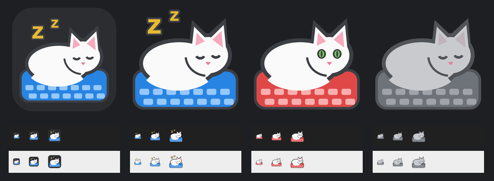

# Cat Lock

Stops the cat typing. A little Windows app for anyone whose cat walks across the
keyboard, sits on it, or leans on the laptop and fires off something silly.

It watches the keyboard and quietly throws away keystrokes that look like paws,
while normal typing goes straight through. A white cat sleeps in the tray while
all is quiet; the keyboard under it turns red when the cat arrives.



## What it blocks

**Typing rules** (each can be switched off)
- **A key held down types once.** Holding `c` gives "c", not "cccccc".
  Backspace, Delete, the arrows, Home/End, Page Up/Down and volume still repeat.
- **Two keys landing at the same moment** (within 30 ms): the second is dropped.
  Fast typing, where the next key goes down before the last one is up, is fine.
- **The same letter three times in a row**: the third is dropped. `www` and
  Roman numerals (`iii`) are allowed. If your language has words like
  *Schifffahrt*, switch this rule off.

**Cat on the keyboard** (always on): three keys landing together, a key pressed
while another has been held for half a second, or two keys held down together.
Everything is blocked until the keyboard has been quiet for a second.

**Bad shortcuts** (tick boxes, sensible defaults): Win+X power menu, Win+P
projector, Narrator, colour filters, Ctrl+Alt+arrows screen rotation, Insert,
Num Lock, Task Manager and more. Any Ctrl/Alt/Win shortcut whose key goes down at
the *same instant* as the modifier is blocked too: people press Ctrl first, paws
press both at once. Shift, Ctrl, Alt and Win themselves are never blocked unless
you tick them.

## Install and run

Windows 10 or 11 and Python 3 (tested with 3.12). No extra packages.

```
pythonw cat_lock.pyw
```

`python shortcuts.py` puts a Cat Lock shortcut on your Desktop. The
**Start with Windows** button in the app starts it hidden in the tray at login.

- Left-click the tray cat to show or hide the window.
- Right-click it for Turn off / Bad shortcuts / Quit.
- The window's X hides it to the tray; it keeps watching.
- Starting it a second time just opens the one already running.

## Privacy

Cat Lock never saves or sends what you type. It makes no network connections.
The list of recently blocked keys lives in memory only and is gone when you quit.
The one file it writes, `cat_lock_settings.json`, holds the window position and
your tick boxes.

## Good to know

- **Games** often hold several keys at once (W + A + Shift...). Turn Cat Lock off
  from the tray while you play.
- Windows doesn't let ordinary apps see keys typed into **programs run as
  administrator**, so those aren't filtered.
- **Win+L** and **Ctrl+Alt+Del** are handled by Windows itself and can't be blocked.
- **Sticky Keys** (Shift pressed 5 times) and **Filter Keys** (Shift held for
  8 seconds) are classic cat traps. Switch their shortcuts off in
  *Settings > Accessibility > Keyboard*.
- Keys typed by software (on-screen keyboard, password managers, remote desktop)
  are never touched.
- Windows 11 hides new tray icons behind the ^ arrow. Drag the cat out, or switch
  it on in *Settings > Personalisation > Taskbar > Other system tray icons*.

## Safety and tests

A keyboard filter must never leave a key "stuck" down. The rules live in
`catfilter.py`, with no Windows calls, so they can be tested on their own:

```
python test_catfilter.py     # 33 tests of each rule
python test_stress.py        # 2 million random key events: no stuck keys, no jams
```

`test_stress.py` plays random key storms (presses, releases, auto-repeat,
modifiers, settings flipped mid-storm, key-ups the hook never sees) and checks
after every event that Windows never still thinks a released key is held.
Pass bigger numbers for a longer run: `python test_stress.py 500 50000`.

If anything inside the rules ever fails, the key goes through rather than being
lost, and Windows' own safety net drops a hook that stops answering.

## Files

| File | What it is |
| --- | --- |
| `cat_lock.pyw` | The app: keyboard hook, tray icon, window |
| `catfilter.py` | The rules and the bad-shortcut list (timings at the top) |
| `shortcuts.py` | Desktop and Start-with-Windows shortcuts |
| `make_art.py` | Draws the logo, tray icons and window art (needs Pillow) |
| `test_catfilter.py`, `test_stress.py` | Tests |

## Licence

MIT, see [LICENSE](LICENSE). Free to use, change and share.
